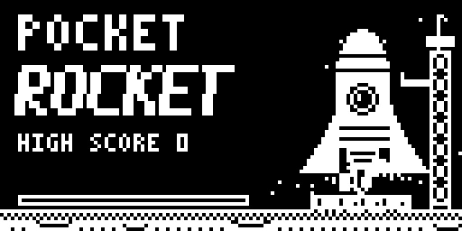
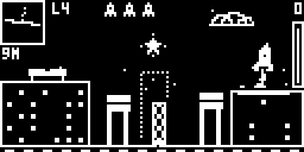
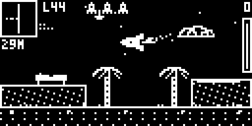

# Pocket Rocket



A 1-bit rocket lander for the Poom, **Arduboy FX** (and FX-C). Fly a tiny rocket across
100 levels in 10 cities and places — Seoul, Venezia, Giza, Paris, Lisboa, Sydney,
Star Base, Siberia, Mariana and Rio — and set it down slow and straight on the pad.

By **jaychugstein** · MIT License · Requires the FX flash chip (Arduboy FX / FX-C / 8BitCade XL).

 

**Included on the Arduboy FX cart** (BigFX list, Skill category).

**[▶ Play it in your browser](https://jaychugstein.github.io/Pocket-Rocket/)** (works on phones too)

## Controls

A is the outer button (labelled A on the POOM), B the inner one.

| Button | Action |
|---|---|
| A (hold) | Thrust |
| Left / Right | Tilt |
| B | Parachute — only with an empty tank and above 100 m |

Hold **A** on the title screen to launch. Land slow and straight on the pad.

## Bonuses

Extra points for 360 / 1080 flips, a perfect landing, finishing with 69% fuel, LIGHT SPEED dives,
a parachute landing and one very particular statue arm in Rio.

## Install

**Arduboy FX / FX-C:** load `release/PocketRocket.hex` together with
`release/PocketRocket-fxdata.bin`, or the packaged `PocketRocket.arduboy`, with
any FX-aware uploader (for example the Arduboy Cart Builder or the
Arduboy-Python-Utilities `uploader.py` + `fxdata-upload.py`).

The game is built with `ARDUBOY_NO_USB` to save space. To upload a different
sketch afterwards, press the reset button when the uploader asks.

## Building from source

The sketch is in `PocketRocket/` and needs the **Arduboy2** and **ArduboyFX** libraries.

* **Arduino IDE / arduino-cli:** open `PocketRocket/PocketRocket.ino`, select an Arduboy board
  (or Arduino Leonardo), compile, then upload
  `PocketRocket/fxdata/fxdata.bin` as the FX development data.
* **Command line:** `./build.sh` (edit the paths at the top). Builds `build/PocketRocket.hex`.

The program uses about 27 KB of the 28 KB available, so it is close to the limit.
The release hex was built with avr-gcc 14.1. Other compiler versions may produce
a slightly larger file.

## Where the data comes from

The game was designed as a browser version first (`browser/lander.html`, playable
in any browser). All level art, collision masks, animations and screens on the
Arduboy are exported from that browser source so both versions match:

```
cd export && ./build_data.sh      # needs node and python3
```

This regenerates everything in `PocketRocket/fxdata/` plus `fxdata.h` and `screens.h`.

## Porting (POOM and other Arduboy-compatible devices)

* All game logic is in `PocketRocket/game.cpp` and only uses `Arduboy2Base`
  (buttons, frame timing, `sBuffer`), `ArduboyFX` (`FX::begin`, `FX::readDataBytes`,
  `FX::seekData`, `FX::readPendingUInt8`, `FX::readEnd`, `FX::display`) and EEPROM.
* `tools/hosttest.cpp` builds the unchanged game on a PC with small stand-ins in
  `tools/shim/` (FX reads come straight from `fxdata.bin` in memory). It runs an
  autopilot across all 100 levels:
  ```
  cd tools && g++ -O2 -std=c++17 -w -Ishim -o hosttest hosttest.cpp && ./hosttest
  ```
  It's a handy reference for porting to non-AVR hardware.
* FX data is about 1.5 MB.
* The high score is saved at EEPROM address 32 (4 bytes).

## License

MIT — see [LICENSE](LICENSE). Uses the Arduboy2 (BSD 3-Clause) and ArduboyFX (CC0) libraries.
